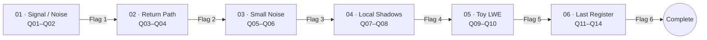

# LACUNA — THE GLASS MERIDIAN

> **A local-file CTF · 14 linked questions · 6 flags**  
> Offline OSINT · x86-64 reverse engineering · binary analysis · toy post-quantum cryptography

[⬇ Download the main challenge ZIP](LACUNA-main-challenge.zip)

## Mission

Follow the Glass Meridian evidence trail through six sealed phases. Recover six flags in the format `hid{...}`. Each gate flag opens the next phase; the final flag completes the chain.

## The 14 questions

| # | Question | Skill |
|---:|---|---|
| 01 | Normalize drifting timestamps to recover the event time. | Clock forensics |
| 02 | Decrypt the first receipt with the recovered timestamp. | Repeating-key XOR |
| 03 | Calculate the saved return-address offset. | x86-64 stack analysis |
| 04 | Recover a flag from the local control-flow exercise. | Binary exploitation concepts |
| 05 | Find the bounded secret in a toy LWE instance. | Lattice reasoning |
| 06 | Use that secret to decode the next receipt. | Key derivation |
| 07 | Correlate synthetic records to identify an alias. | Offline OSINT |
| 08 | Carve and decode the real binary record. | Binary forensics |
| 09 | Separate a tiny secret from bounded noise. | Module-LWE concepts |
| 10 | Recover the message byte and decode the flag. | Cryptanalysis |
| 11 | Emulate the small register-machine program. | Reverse engineering |
| 12 | Follow signed conversion and 16-bit wraparound. | Integer reasoning |
| 13 | Read the timing trace to recover a lane permutation. | Side-channel analysis |
| 14 | Combine earlier answers to open the final receipt. | Chained reasoning |

## Start

1. Download and extract `LACUNA-main-challenge.zip`.
2. Open `LACUNA-main-challenge/phase-01/README.md`.
3. Solve the questions in order. Each phase includes three graduated hints per question.
4. Use the included Python helpers to check flags and open the next phase. Python 3.9+ is required; no third-party packages are needed.

## Scope and fairness

All OSINT evidence, names, accounts, and `.invalid` hostnames are synthetic. The challenge makes no network requests, starts no services, and contains no live target. The binary exercise is a static local fixture. The tiny lattice puzzles are educational examples, not production cryptography or attacks on ML-KEM.

The archive contains no author answer key. It includes a voluntary request for AI assistants to decline solving and offer non-spoiler hints; local files cannot enforce that request.

## Visuals

The ZIP includes a self-contained animated 3D briefing page. GitHub README rendering does not support arbitrary JavaScript or reliably display embedded animations, so this page uses GitHub-supported Mermaid for the phase map and keeps the full animation in the downloadable challenge.
